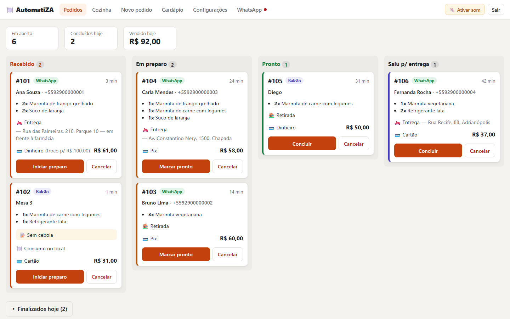
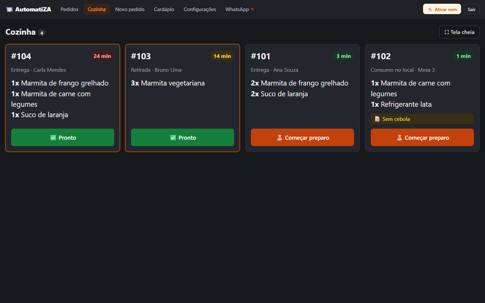
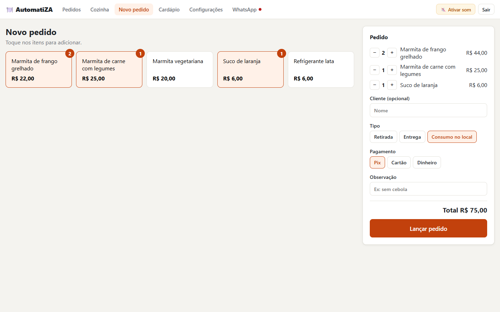
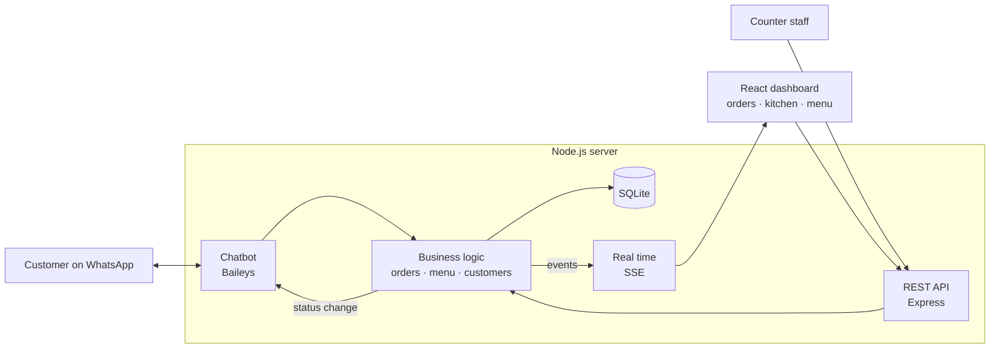

<div align="center">

# 🍽️ AutomatiZA

**Restaurant ordering system with automated WhatsApp customer service**

Customers order through WhatsApp, the order shows up instantly on the dashboard and the kitchen screen,
and the customer gets notified at every step of preparation.


[🇧🇷 Português](README.md) · 🇺🇸 English

</div>



> The interface and the chatbot are in Brazilian Portuguese, since the product targets restaurants in Brazil.

## The problem

In Brazil, small restaurants take a large share of their orders through
WhatsApp and handle everything by hand: sending the menu, writing down the
order, adding up the total, asking for the address and answering "where's my
food?". During rush hour, messages get lost and orders go out wrong.

**AutomatiZA** automates this conversation and organizes the operation. It
runs on a computer inside the restaurant, with no monthly server costs.

## Features

**🤖 WhatsApp chatbot**
- Sends the menu and understands orders like `2x1, 4` (two of item 1, one of item 4)
- Asks for the delivery address (offering the last one used), adds the delivery fee, and asks for payment method and change
- **Automatically notifies the customer** when the order starts cooking, is ready, or is out for delivery
- Hands the conversation over to a human when the customer asks, or when staff reply from the restaurant's phone

**🖥️ Web dashboard** (computer, tablet or phone on the restaurant's network)
- **Real-time** order board with a sound alert for new orders and a daily sales summary
- Dark-mode **kitchen display** with large text and timers that change color as orders run late
- Walk-in and phone order entry
- Editable menu: disabling an item removes it from WhatsApp immediately
- WhatsApp connection via QR code right from the dashboard

<table>
  <tr>
    <td width="50%"></td>
    <td width="50%"></td>
  </tr>
  <tr>
    <td align="center"><sub>Kitchen display</sub></td>
    <td align="center"><sub>Walk-in order</sub></td>
  </tr>
</table>

## Architecture



## Technical decisions

- **Real-time updates with Server-Sent Events.** The dashboard receives new
  orders and status changes without reloading and without extra libraries.
  SSE is simpler than WebSockets when data only flows from server to browser.
- **Chatbot decoupled from the WhatsApp library.** The conversation flow
  (`conversa.js`) takes text in and returns the messages to send, without
  knowing about Baileys. Switching to Meta's official API means rewriting
  only `conexao.js`.
- **Money stored in cents.** Prices are integers in the database, which
  avoids floating-point rounding errors (`0.1 + 0.2 !== 0.3`).
- **Orders keep the price at the time of sale.** Each item's name and price
  are stored in the order, so later menu changes don't rewrite history.
  Prices always come from the database, never from the client.
- **State machine for order status.** The server validates transitions (a
  delivery can't be completed before it's dispatched), and every change is
  recorded in a history table.
- **Ready for multiple restaurants.** Every table has a `restaurante_id`, so
  it can become multi-tenant SaaS without redesigning the database.
- **Zero infrastructure.** It uses the SQLite built into Node.js
  (`node:sqlite`) with versioned migrations. Just install Node, with no
  database server to set up.
- **Safe on a shared network.** The dashboard requires a password (generated
  on first run), since customers may be on the restaurant's Wi-Fi. Logins
  use HMAC-signed tokens.

## Getting started

Requirement: [Node.js](https://nodejs.org) 22.13 or newer.

```bash
git clone https://github.com/JoshuaDun04/automatiza-pedidos-whatsapp.git
cd automatiza-pedidos-whatsapp
npm install
npm run build     # builds the dashboard
npm run demo      # optional: creates sample orders
npm start
```

Open `http://localhost:3000` and log in with the password shown in the
terminal (it's saved in the `.env` file). The terminal also shows the
address for opening the dashboard on other devices on the network.

To turn on the chatbot, open **WhatsApp** in the dashboard and scan the QR
code with the restaurant's phone. To try only the dashboard without
WhatsApp, add `WHATSAPP=desligado` to `.env`.

## Roadmap

- [x] WhatsApp ordering chatbot with human handoff
- [x] Real-time dashboard, kitchen display and walk-in orders
- [ ] **Inventory:** recipes, automatic stock deduction and low-stock alerts
- [ ] **Finance:** cash register, expenses, reports and per-dish margins
- [ ] Automatic Pix payment confirmation and business hours
- [ ] Official WhatsApp API (Meta Cloud API)

## ⚠️ About the WhatsApp connection

This project uses [Baileys](https://github.com/WhiskeySockets/Baileys), an
**unofficial** library that works like WhatsApp Web. It's great for demos
and pilots, but WhatsApp may block numbers used for automation. Use a number
dedicated to the bot. For commercial use at scale, the way forward is
[Meta's official API](https://developers.facebook.com/docs/whatsapp/cloud-api),
and the architecture already allows for that switch.

## Author

**Geudes Araújo Gomes Júnior**, Computer Engineering student (Faculdade
Matias Machline, Manaus, Brazil).

[MIT](LICENSE) licensed.
