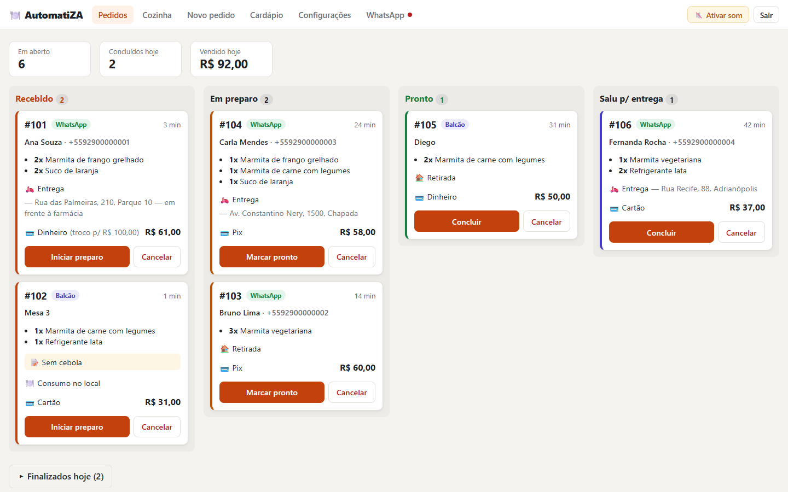
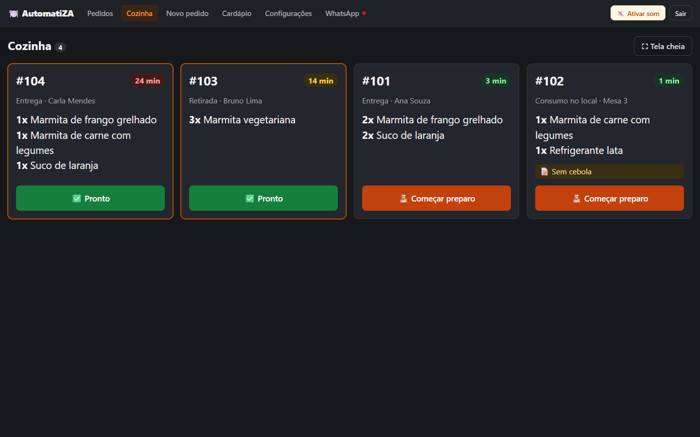
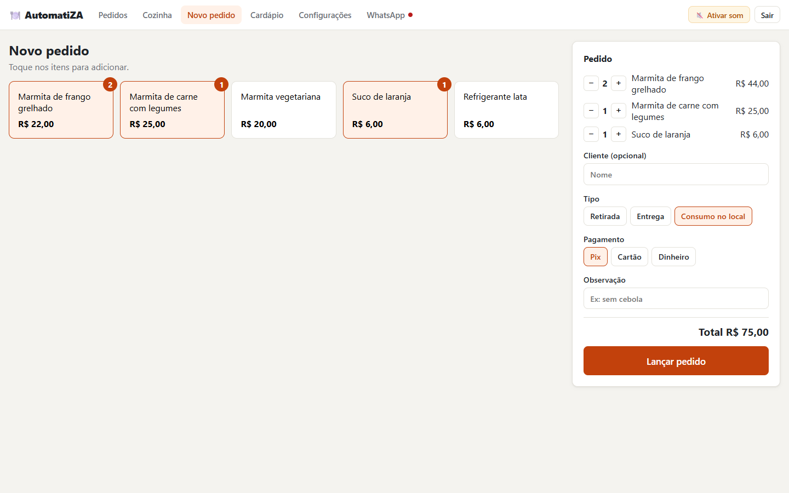
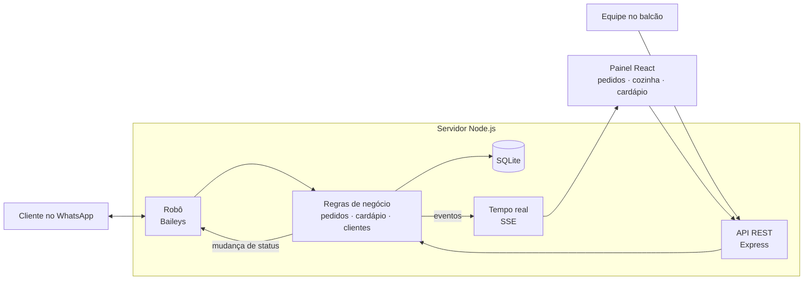

<div align="center">

# 🍽️ AutomatiZA

**Sistema de pedidos para restaurantes com atendimento automático no WhatsApp**

O cliente pede pelo WhatsApp, o pedido aparece na hora no painel e na tela da cozinha,
e o cliente é avisado a cada etapa do preparo.


🇧🇷 Português · [🇺🇸 English](README.en.md)

</div>



## O problema

Restaurantes pequenos recebem boa parte dos pedidos pelo WhatsApp e atendem
tudo na mão: mandam o cardápio, anotam o pedido, calculam o total, perguntam
o endereço e respondem "cadê meu pedido?". No horário de pico, mensagens se
perdem e pedidos saem errados.

O **AutomatiZA** automatiza esse atendimento e organiza a operação, rodando
em um computador do próprio restaurante, sem mensalidade de servidor.

## Funcionalidades

**🤖 Robô no WhatsApp**
- Mostra o cardápio e entende pedidos como `2x1, 4` (duas unidades do item 1 e uma do item 4)
- Pede o endereço (e oferece o da última vez), soma a taxa de entrega e pergunta a forma de pagamento e o troco
- **Avisa o cliente automaticamente** quando o pedido entra em preparo, fica pronto ou sai para entrega
- Passa a conversa para um atendente humano quando o cliente pede ou quando a equipe responde pelo celular

**🖥️ Painel web** (computador, tablet ou celular, na rede do restaurante)
- Quadro de pedidos em **tempo real**, com aviso sonoro de pedido novo e resumo de vendas do dia
- **Tela da cozinha** em modo escuro, com letra grande e cronômetro que muda de cor com o atraso
- Lançamento de pedidos de balcão e telefone
- Cardápio editável: desativar um item o tira do WhatsApp na hora
- Conexão do WhatsApp por QR code direto no painel

<table>
  <tr>
    <td width="50%"></td>
    <td width="50%"></td>
  </tr>
  <tr>
    <td align="center"><sub>Tela da cozinha</sub></td>
    <td align="center"><sub>Pedido de balcão</sub></td>
  </tr>
</table>

## Arquitetura



## Decisões técnicas

- **Tempo real com Server-Sent Events.** O painel recebe pedidos novos e
  mudanças de status sem recarregar a página e sem biblioteca extra. SSE é
  mais simples que WebSocket quando os dados só vão do servidor para o navegador.
- **Robô separado da biblioteca do WhatsApp.** O fluxo da conversa
  (`conversa.js`) recebe texto e devolve as mensagens a enviar, sem conhecer
  a Baileys. Trocar pela API oficial da Meta significa reescrever só a `conexao.js`.
- **Valores em centavos.** Preços são inteiros no banco, o que evita os erros
  de arredondamento do ponto flutuante (`0.1 + 0.2 !== 0.3`).
- **O pedido guarda o preço da venda.** Nome e preço de cada item ficam
  gravados no pedido, então mudar o cardápio depois não altera o histórico.
  O preço vem sempre do banco, nunca do cliente.
- **Máquina de estados para o status.** O servidor valida as transições
  (não dá para concluir uma entrega que não saiu), e cada mudança fica
  registrada em um histórico.
- **Pronto para vários restaurantes.** Todas as tabelas têm `restaurante_id`,
  para virar SaaS sem refazer o banco.
- **Zero infraestrutura.** O banco usa o SQLite embutido no Node.js
  (`node:sqlite`), com migrações versionadas. Basta instalar o Node, sem
  banco de dados para configurar.
- **Seguro na rede local.** O painel exige senha (gerada no primeiro uso),
  porque clientes podem estar no Wi-Fi do restaurante. Os logins são tokens
  assinados com HMAC.

## Como rodar

Pré-requisito: [Node.js](https://nodejs.org) 22.13 ou mais novo.

```bash
git clone https://github.com/Melinyel04/automatiza-pedidos-whatsapp.git
cd automatiza-pedidos-whatsapp
npm install
npm run build     # gera o painel
npm run demo      # opcional: cria pedidos de exemplo
npm start
```

Abra `http://localhost:3000` e entre com a senha que aparece no terminal
(ela fica salva no arquivo `.env`). O terminal também mostra o endereço
para abrir o painel em outros aparelhos da rede.

Para ativar o robô, vá em **WhatsApp** no painel e escaneie o QR code com o
celular do restaurante (**Configurações → Aparelhos conectados → Conectar
aparelho**). Para testar só o painel, sem WhatsApp, coloque
`WHATSAPP=desligado` no `.env`.

<details>
<summary><b>Desenvolvimento</b></summary>

```bash
npm run dev       # servidor com reinício automático (porta 3000)
npm run dev:web   # painel com recarga instantânea (porta 5173)
```

Para mudar o banco, acrescente uma migração nova no fim da lista em
`server/db.js`. Nunca edite uma migração que já rodou.
</details>

<details>
<summary><b>Como funciona a conversa no WhatsApp</b></summary>

1. Cliente manda qualquer mensagem → boas-vindas + cardápio
2. Escolhe os itens pelo número, com quantidade se quiser (`2x1, 4`)
3. Confirma → retirada ou entrega
4. Entrega: pede o endereço (ou oferece o da última vez) e soma a taxa
5. Pagamento: Pix (mostra a chave), cartão ou dinheiro (pergunta o troco)
6. O pedido entra no painel e na cozinha, e uma cópia vai para o WhatsApp do dono
7. A cada mudança de status, o cliente recebe um aviso

Comandos que o cliente pode usar a qualquer momento: `cardapio`, `cancelar`
e `atendente`. Quando alguém da equipe responde pelo celular do
restaurante, o robô para naquela conversa. Ele volta quando a equipe manda
`#bot` na conversa, ou sozinho depois de um tempo sem mensagens.
</details>

## Estrutura

```
server/
  index.js            inicia API, painel e WhatsApp
  db.js               banco SQLite e migrações
  auth.js             senha do painel e tokens de login
  rotas.js            API REST + canal de eventos (SSE)
  servicos/           regras de negócio: pedidos, produtos, clientes, restaurante
  whatsapp/
    conversa.js       fluxo da conversa (independente da Baileys)
    conexao.js        conexão com o WhatsApp (Baileys)
    formatacao.js     textos das mensagens
web/src/
  paginas/            Pedidos, Cozinha, Novo pedido, Cardápio, Configurações, WhatsApp
  hooks.js            dados em tempo real
scripts/demo.js       pedidos de exemplo
```

## Roteiro

- [x] Robô de pedidos no WhatsApp com passagem para atendente
- [x] Painel em tempo real, tela da cozinha e pedidos de balcão
- [ ] **Estoque:** ficha técnica, baixa automática e alerta de estoque mínimo
- [ ] **Financeiro:** caixa, despesas, relatórios e margem por prato
- [ ] Pix com confirmação automática e horário de funcionamento
- [ ] API oficial do WhatsApp (Meta Cloud API)

## ⚠️ Sobre a conexão com o WhatsApp

Este projeto usa a [Baileys](https://github.com/WhiskeySockets/Baileys), uma
biblioteca **não oficial** que funciona como o WhatsApp Web. Ela é ótima
para demonstração e piloto, mas o WhatsApp pode bloquear números com uso
automatizado. Use um número dedicado ao robô. Para uso comercial em escala,
o caminho é a [API oficial da Meta](https://developers.facebook.com/docs/whatsapp/cloud-api),
e a arquitetura já prevê essa troca.

## Autor

**Geudes Araújo Gomes Júnior**, estudante de Engenharia da Computação
(Faculdade Matias Machline, Manaus/AM).

Licença [MIT](LICENSE).
